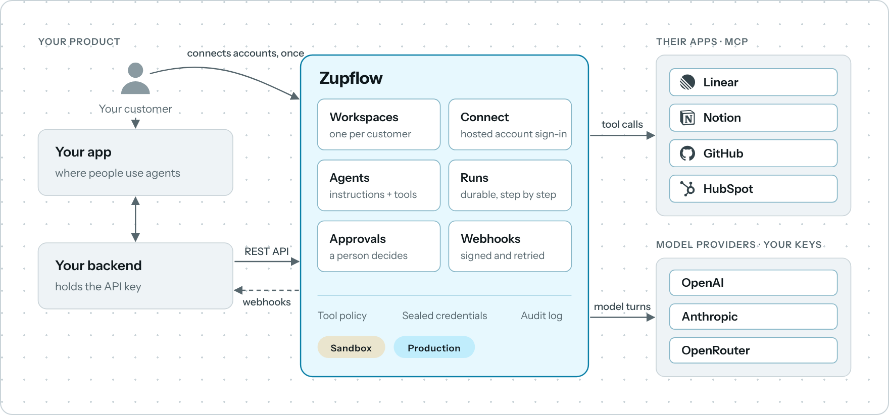
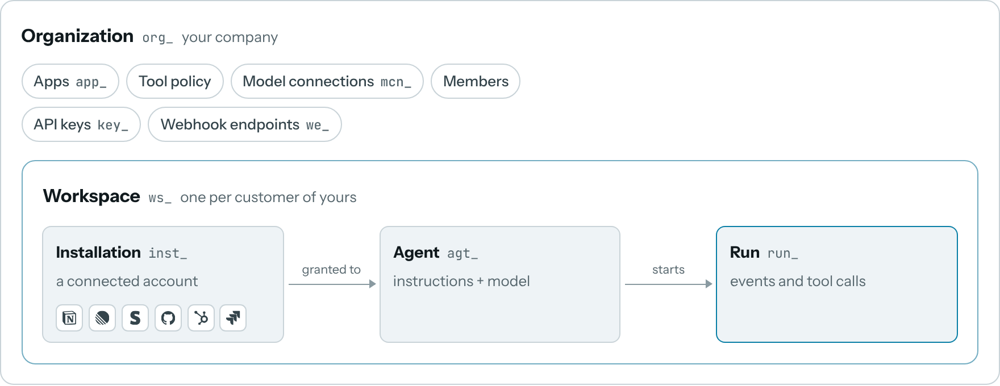
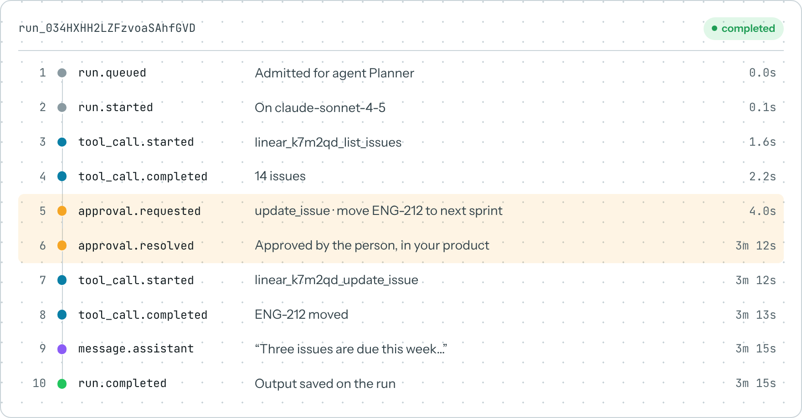
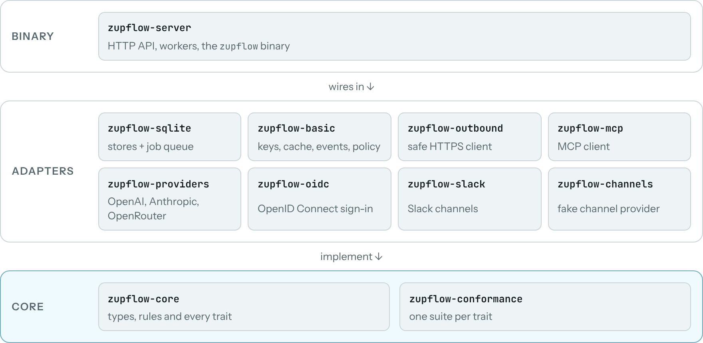

<p align="center">
  <picture>
    <source media="(prefers-color-scheme: dark)" srcset="packages/brand/02-horizontal/zupflow-horizontal-cyan-white.svg">
    
  </picture>
</p>

<p align="center">
  <strong>The backend for adding AI agents to your product.</strong><br>
  Your customers connect their accounts. Agents use the tools you allow. You hear about every step.
</p>

<p align="center">
  <a href="https://docs.zupflow.com/introduction/">Documentation</a> ·
  <a href="https://docs.zupflow.com/quickstart/">Quickstart</a> ·
  <a href="https://docs.zupflow.com/reference/api/">API reference</a> ·
  <a href="https://docs.zupflow.com/self-hosting/overview/">Self-hosting</a> ·
  <a href="LICENSE">Apache-2.0</a>
</p>

---

## What is Zupflow?

Zupflow gives your product agents that act in your customers' own accounts, such as their Notion, Linear or Stripe, without you building OAuth flows, token storage, tool calling, approvals or a durable run loop.

Your product stays the one your customers see. Your backend talks to Zupflow's API, and Zupflow talks to the apps and the models.

<picture>
  <source media="(prefers-color-scheme: dark)" srcset=".github/readme/product-dark.png">
  
</picture>

| You build | Zupflow handles |
| --- | --- |
| Your product and its interface | Connecting accounts, with a hosted Connect page |
| Which agents exist and what they're for | Keeping credentials encrypted and refreshed |
| Which tools each agent may use | Discovering tools and pinning their definitions |
| How you ask a person before sensitive actions | Deciding every tool call against your policy |
| What happens when a run finishes | Running the agent to the end, through restarts |

## How it fits together

Your organization holds your setup. Each of your customers gets a **workspace**, and nothing in one workspace ever reaches another.

<picture>
  <source media="(prefers-color-scheme: dark)" srcset=".github/readme/objects-dark.png">
  
</picture>

- **Apps** are services agents can use through their MCP servers. Your customers connect them through **Connect**, which creates an **installation**.
- **Agents** get named tools from an installation through a **grant**, and you mark which of those tools need a person's approval.
- A **run** is one task for an agent. It calls the model, sends the tool calls your policy allows, pauses for approvals and records every step.

## A run, end to end

```ts
import { createClient, createHttpTransport } from "@zupflow/sdk";

const zupflow = createClient(
  createHttpTransport({
    baseUrl: process.env.ZUPFLOW_URL!,
    getToken: async () => process.env.ZUPFLOW_API_KEY!,
  }),
);

// 1. A workspace for the customer, with your own ID for them.
const workspace = await zupflow.workspaces.create(organizationId, {
  name: "Acme Corp",
  slug: "acme",
  environment: "sandbox",
  external_id: customer.id,
});

// 2. Send them through hosted Connect to link their Linear account.
const session = await zupflow.connectSessions.create(workspace.id, {
  app_id: linearAppId,
  intent: "create",
  label: "Linear",
  installation_id: null,
  return_url: "https://app.example.com/integrations",
});
redirect(session.url);

// 3. An agent, granted the account's tools. Updates wait for a person.
const agent = await zupflow.agents.create(workspace.id, {
  name: "Planner",
  description: "Plans the week from the team's Linear issues.",
  instructions: "You help the team plan their week. Be brief.",
  model_id: null, // the environment's default model
});
await zupflow.grants.create(workspace.id, agent.id, {
  installation_id: installationId,
  tools: ["list_issues", "update_issue"],
  approval_required: ["update_issue"],
});

// 4. Start a run. Webhooks tell your backend how it goes.
await zupflow.runs.create(workspace.id, agent.id, {
  input: "What's due this week? Move anything overdue to next sprint.",
});
```

<picture>
  <source media="(prefers-color-scheme: dark)" srcset=".github/readme/run-dark.png">
  
</picture>

The [Quickstart](https://docs.zupflow.com/quickstart/) takes you from an API key to your first run in about ten minutes. [Build your first agent](https://docs.zupflow.com/guides/first-agent/) goes end to end, webhooks included.

## What you get

- **Hosted Connect.** OAuth (including MCP's own, with dynamic registration), configured OAuth clients, or pasted tokens. Use a redirect or a popup.
- **Credentials you never hold.** Encrypted at rest, refreshed before they expire, and opened only to call that account's tools.
- **A tool policy with a floor.** An organization level for every tool (`allow`, `approve` or `deny`), per-agent grants, and a check again just before each call is sent.
- **Approvals in your product.** The run pauses, your product asks the person, and your backend sends the decision.
- **Durable runs.** Every step is saved before it's taken. A call whose outcome was lost is never sent twice.
- **Signed webhooks.** At least once, retried for about two days, with secrets you can rotate without downtime.
- **Your own model accounts.** Connect Anthropic, OpenAI or OpenRouter per environment, and pick a default model.
- **Sandbox and Production.** Separate keys, configuration and data, with no fallback from one to the other.
- **A Console** for your team to configure apps, policy, models, keys and webhooks, and to watch runs.

## Self-hosting

Zupflow is open source under Apache-2.0. This repository holds the whole platform: the API server, the hosted Connect page, the Console, the TypeScript SDK and the API contract.

<picture>
  <source media="(prefers-color-scheme: dark)" srcset=".github/readme/crates-dark.png">
  
</picture>

The server is written in Rust and runs as one binary, with its data in one SQLite file. Every external resource (the database, job queue, keys, cache and model providers) sits behind a trait with a working implementation, so you can swap in Postgres, a managed key service or a shared cache without forking.

Try it locally with Node 22+, pnpm 10 and Rust:

```bash
git clone https://github.com/zupflow-hq/zupflow.git
cd zupflow
pnpm install

# The server, on :8080, with no sign-in and a scripted model
ZUPFLOW_CONSOLE_ORIGIN=http://localhost:5180 pnpm --filter @zupflow/server dev

# The Console, on :5180, in another terminal
VITE_ZUPFLOW_API_URL=http://localhost:8080 pnpm dev
```

Or run only the Console, against an in-browser mock of the API, with `pnpm dev`.

The [self-hosting docs](https://docs.zupflow.com/self-hosting/overview/) cover running the server, its configuration and the [architecture](https://docs.zupflow.com/self-hosting/architecture/overview/).

## Repository

```
apps/console       The Console: React, TanStack Router and Query
apps/docs          The documentation site: Astro Starlight
packages/contract  The API contract: zod schemas, routes and openapi.json
packages/sdk       @zupflow/sdk: a typed client and webhook verification
packages/contract-tests  The black-box suite every server must pass
server/            The Rust server: a Cargo workspace of core, adapters and the binary
```

The contract comes first: the server, the SDK, the Console's mock and the API reference all follow `packages/contract`.

## Contributing

[DEVELOPMENT.md](DEVELOPMENT.md) covers running every part, the backend's settings, the test suites and how the Console is built. [AGENTS.md](AGENTS.md) holds the rules every change follows. Before a pull request, run:

```bash
pnpm check   # lint, format, typecheck, tests and build, Rust included
```

## License

[Apache-2.0](LICENSE). The brand assets and their usage notes are in [`packages/brand`](packages/brand).
