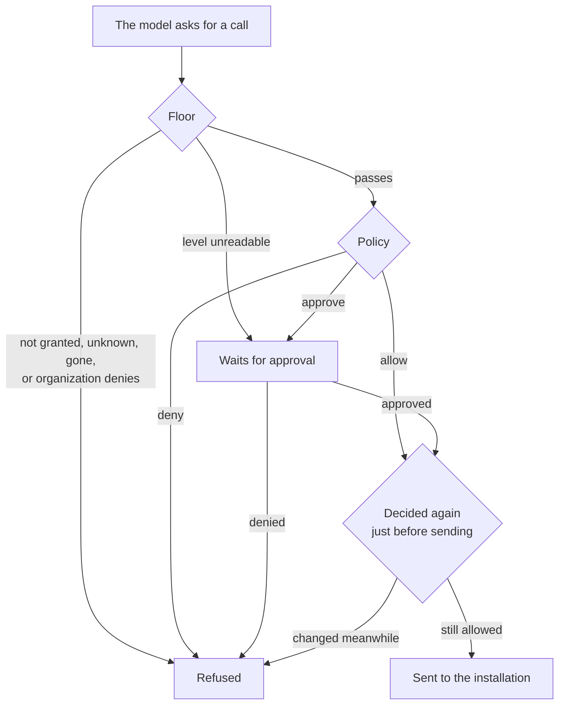

import ToolDecisions from "../../../components/ToolDecisions.astro";

## Agents

An **agent** belongs to a workspace. It has a name, a description, **instructions** and a model: one of its environment's models, or `null` to use the environment's default.

```ts
const agent = await zupflow.agents.create(workspaceId, {
  name: "Planner",
  description: "Plans the week from the person's tasks.",
  instructions: "You help the person plan their week. Be brief.",
  model_id: null, // the environment's default model
});
```

A `paused` agent refuses new runs (`422 agent_paused`).

## Grants

A **grant** gives an agent named tools of one installation in the same workspace, and marks which of them need approval.

```ts
await zupflow.grants.create(workspaceId, agent.id, {
  installation_id: installationId,
  tools: ["list_tasks", "create_task"],
  approval_required: ["create_task"],
});
```

A grant can only name tools the installation's registry holds (`422 unknown_tool`, `422 tool_gone`). A tool that disappears later stays in the grant and is refused when called.

The model sees each granted tool as `<app_key>_<short_id>_<tool_name>`, for example `taskboard_k7m2qd_create_task`, so two accounts of the same app never collide.

## Tool policy

The organization's **tool policy** bounds every grant of a catalog app. Each tool has a level:

| Level | Meaning |
| --- | --- |
| `allow` | Calls run without asking. |
| `approve` | Every call waits for an approval. |
| `deny` | Never offered to the model, never called. |

When an app lists a new tool, Zupflow **suggests** a level from its hints (read-only tools `allow`, the rest `approve`, destructive ones flagged), but only a level someone confirmed is in force. Tools nobody has confirmed get the policy's default, `approve` or `deny`. A grant is held inside the levels in force (`422 tool_denied`, `422 approval_required_by_policy`), and tightening a level later needs no grant rewritten.

## How a call is decided

<ToolDecisions />



Three layers decide every call a model asks for, and the strictest wins: the installation's tool registry, the organization's level for the tool, and the agent's grant.

1. **The floor** comes first, and no policy can widen it. A tool that isn't granted, isn't in the registry, is gone, or that the organization has confirmed as `deny` is refused. One whose level can't be read waits for approval, so the floor fails closed.
2. **The policy** then decides from the organization's level and the grant's `approval_required`: run it, wait for approval, or refuse it.
3. **Just before sending,** the call is decided again on what holds then. A call that now needs approval waits for it; one now refused, whose installation was removed or disconnected, or whose tool changed since, isn't sent.

A workspace app's tools have no organization level: its grants alone decide, inside the floor.
