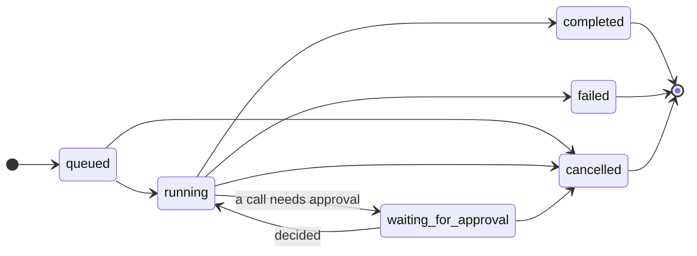

import RunTimeline from "../../../components/RunTimeline.astro";

## Runs

A **run** is one task for an agent: an input in, a model's answer out, with any tool calls in between.

```ts
const run = await zupflow.runs.create(workspaceId, agentId, { input: "What's due this week?" });
```

A run's `status` moves through:



The run records its model and connection when it starts, and checks before every model call that both are still there. With neither an agent model nor an environment default, starting a run is refused (`422 model_not_configured`).

## Events

Every step is an event with a `sequence` number. Read them all, or only those after a sequence you already have:

```ts
const events = await zupflow.runs.events(workspaceId, run.id, lastSequence);
```

| Event | When |
| --- | --- |
| `run.queued`, `run.started` | Admitted, then taken up with its model. |
| `message.assistant` | The model said something. |
| `tool_call.started`, `tool_call.completed`, `tool_call.failed` | A call was sent and answered. |
| `approval.requested`, `approval.resolved` | A call waits for a decision, then gets one. |
| `run.completed`, `run.failed`, `run.cancelled` | The run ended. |

<RunTimeline />

For anything you need to react to, prefer [webhooks](/concepts/webhooks/) over polling events.

## Approvals

When a call needs approval, the run pauses with `waiting_for_approval`, records `approval.requested` with the call's ID and arguments, and Zupflow sends the `run.waiting_for_approval` webhook. Your product shows the person what the agent wants to do; your backend sends the decision:

```ts
await zupflow.runs.resolveApproval(workspaceId, runId, {
  call_id: callId,
  decision: "denied",
  reason: "Not this week.", // optional, goes back to the model
});
```

- **Only an API key can decide.** A Console session gets `403 approval_requires_api_key`: the Console observes approvals, the person decides in your product.
- A denial's `reason` goes back to the model as the call's result, so it can carry on without the call.
- Deleting or disconnecting the installation refuses its waiting calls, so the run goes on without anyone deciding. A decision sent after that answers `409 not_waiting`.

## Cancelling

`POST /v1/workspaces/{ws}/runs/{run}/cancel` stops a run and closes every call not yet sent.

## Durability

Runs survive interruptions. Each step is saved before it's taken, and a call whose outcome was lost mid-send is settled as **unknown**, never sent again. A run nothing can take forward any more fails with `run_unavailable`.
