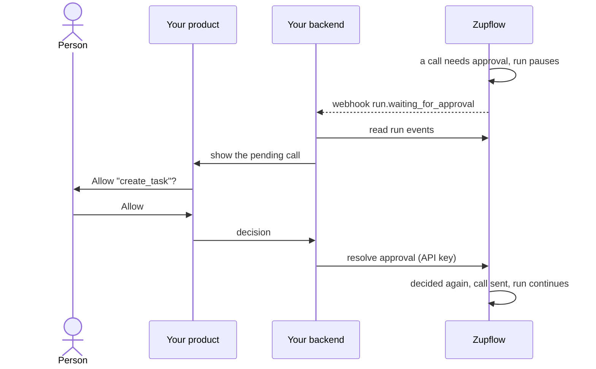

import { Steps } from "@astrojs/starlight/components";
import ApprovalPrompt from "../../../components/ApprovalPrompt.astro";

When an agent wants to do something that needs approval, Zupflow pauses the run. Your product asks the person; your backend sends their decision. The Console only observes.

<div class="zf-guide-meta not-content">
  <div><span>You'll build</span>An approval prompt in your product, wired to Zupflow</div>
  <div><span>Time</span>About 15 minutes</div>
  <div><span>You need</span>An agent with a grant, and a webhook endpoint (see <a href="/guides/first-agent/">Build your first agent</a>)</div>
</div>



## What the person sees

<ApprovalPrompt />

## Steps

<Steps>

1. **Mark tools as needing approval.**

   Either the organization's tool policy sets a tool's level to `approve`, or a grant lists it in `approval_required`:

   ```ts
   await zupflow.grants.create(workspaceId, agentId, {
     installation_id: installationId,
     tools: ["list_tasks", "create_task", "delete_task"],
     approval_required: ["create_task", "delete_task"],
   });
   ```

2. **Hear that a run is waiting.**

   Subscribe an endpoint to `run.waiting_for_approval`. The event names the workspace (with your `external_id`) and the run.

3. **Find what it wants to do.**

   Read the run's events and take the latest `approval.requested` that has no `approval.resolved` yet:

   ```ts
   const events = await zupflow.runs.events(workspaceId, runId);
   const resolved = new Set(events.filter((e) => e.type === "approval.resolved").map((e) => e.data.call_id));
   const pending = events.filter((e) => e.type === "approval.requested" && !resolved.has(e.data.call_id));
   // each has data.call_id, the tool and data.arguments
   ```

   Show the person the tool and its arguments in your own words.

4. **Send the decision.**

   ```ts
   await zupflow.runs.resolveApproval(workspaceId, runId, {
     call_id: callId,
     decision: "approved", // or "denied"
   });
   ```

   An approved call is decided once more just before it's sent; if something changed meanwhile, it may still be refused. A `reason` with a denial (up to 500 characters) goes back to the model as the call's result.

</Steps>

## Things to know

- Decisions need an **API key** of the run's environment. A Console session gets `403 approval_requires_api_key`.
- A run waits as long as it takes. Deleting or disconnecting the installation refuses its waiting calls, and the run continues.
- A decision for a call that no longer waits answers `409 not_waiting`. Treat it as already handled.
