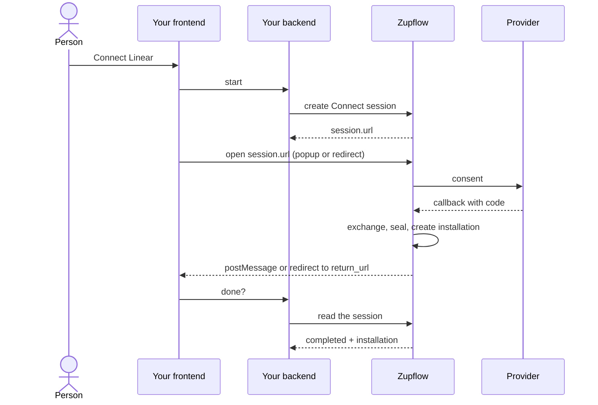

import { Aside, Steps } from "@astrojs/starlight/components";
import ConnectFlow from "../../../components/ConnectFlow.astro";

Your customer clicks **Connect Linear** in your product. This guide takes them through Zupflow's hosted Connect page and back.

<div class="zf-guide-meta not-content">
  <div><span>You'll build</span>A Connect button that links a customer's account, in a tab or a popup</div>
  <div><span>Time</span>About 15 minutes</div>
  <div><span>You need</span>An app configured in the environment, and a workspace</div>
</div>

<ConnectFlow />

## Before you start

In the Console, under **Developers → Connect**, set for each environment:

- **Return URLs**: the exact URLs Connect may send people back to. No wildcards.
- **Allowed origins**: the origins allowed to frame the page or open it in a popup and hear its message. In Sandbox, `http://localhost` is allowed too.

The app must be configured in that environment, too.

## The flow



<Steps>

1. **Your backend creates a session** with an API key of the workspace's environment.

   ```ts
   const session = await zupflow.connectSessions.create(workspaceId, {
     app_id: appId,
     intent: "create",
     label: "Work Linear",
     installation_id: null,
     return_url: "https://app.example.com/integrations",
   });
   return { url: session.url, sessionId: session.id };
   ```

2. **Your frontend sends the person to `session.url`**, in a redirect or a popup. The page runs the OAuth consent or asks for the token, then seals the credentials into an installation.

3. **The person comes back.**
   - In a tab, a completed session redirects to `return_url` with `zupflow_session=<session id>` added.
   - In a popup, the page posts `{ type: "zupflow.connect.finished", session_id, status }` to the opener and closes.

4. **Your backend reads the session** to know the outcome, and its installation.

   ```ts
   const session = await zupflow.connectSessions.get(workspaceId, sessionId);
   if (session.status === "completed") {
     // the installation is connected; its tools are being listed
   }
   ```

</Steps>

<Aside type="caution" title="The message is a hint, not a result">
  Check the message's origin, then read the session through the API before believing it. Keep polling too: a window the
  provider's sign-in passed through may have lost its opener, so the message may never come.
</Aside>

## A popup, end to end

```ts
function connect(url: string, sessionId: string) {
  const popup = window.open(url, "zupflow-connect", "width=520,height=720");
  return new Promise<void>((resolve) => {
    const done = () => {
      window.removeEventListener("message", onMessage);
      clearInterval(timer);
      resolve();
    };
    const onMessage = (event: MessageEvent) => {
      if (event.origin !== new URL(ZUPFLOW_URL).origin) return;
      if (event.data?.type === "zupflow.connect.finished" && event.data.session_id === sessionId) done();
    };
    window.addEventListener("message", onMessage);
    // The popup may lose its opener: poll your backend as well.
    const timer = setInterval(async () => {
      if (popup?.closed || (await sessionFinished(sessionId))) done();
    }, 2000);
  });
}
```

Whatever ends the wait, ask your backend for the session's status before showing a result.

## Reconnecting

When an installation's credentials stop working, Zupflow sends `installation.reconnect_required`. Create a session with `intent: "reconnect"` and the `installation_id`; the installation keeps its ID, `short_id` and grants.

## Webhooks instead of polling

`connect_session.completed`, `connect_session.failed` and `installation.connected` tell your backend the same thing without polling. See [Webhooks](/concepts/webhooks/).
