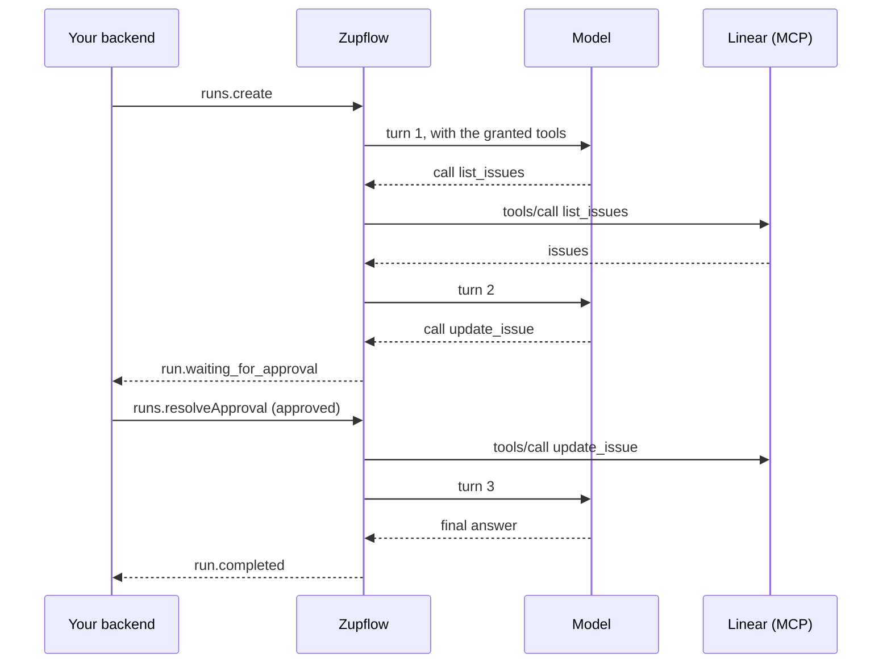

import { Aside, Steps } from "@astrojs/starlight/components";
import StepStrip from "../../../components/StepStrip.astro";

This guide wires Zupflow into a product, end to end. A new customer signs up, connects their Linear account, and an agent plans their week with the tools you allow it, while your backend hears about every step.

<div class="zf-guide-meta not-content">
  <div><span>You'll build</span>A backend that onboards a customer, connects an account and runs an agent</div>
  <div><span>Time</span>About 20 minutes</div>
  <div><span>You need</span>Your Zupflow API URL, a Sandbox API key and a model (see the <a href="/quickstart/">Quickstart</a>)</div>
</div>

<StepStrip
  steps={[
    { title: "Workspace", text: "For the new customer" },
    { title: "Connect", text: "They link Linear" },
    { title: "Agent", text: "And the tools it may use" },
    { title: "Webhook", text: "Hear about every run" },
    { title: "Run", text: "And read its result" },
  ]}
/>

## Set up the client

Every call comes from your backend, with an API key of one environment. Keep the key out of the browser.

```ts title="zupflow.ts"
import { createClient, createHttpTransport } from "@zupflow/sdk";

export const zupflow = createClient(
  createHttpTransport({
    baseUrl: process.env.ZUPFLOW_URL!, // your Zupflow API URL
    getToken: async () => process.env.ZUPFLOW_API_KEY!, // zf_test_… for Sandbox
  }),
);
```

The SDK returns the response's `data` directly, throws a typed error on failure, and sets an `Idempotency-Key` on every `POST`, so a retried call never acts twice.

## Steps

<Steps>

1. **Create a workspace when a customer signs up.** One per customer of yours, with your own ID for them as `external_id`. It comes back on every webhook, so you never need to store Zupflow's IDs to route events.

   ```ts
   const workspace = await zupflow.workspaces.create(organizationId, {
     name: "Acme Corp",
     slug: "acme",
     environment: "sandbox",
     external_id: customer.id,
   });
   ```

2. **Send the customer through hosted Connect.** Create a session for the app, then redirect them to its URL (or open it in a popup). Zupflow runs the sign-in, seals the credentials into an **installation**, and lists the app's tools in the background.

   ```ts
   const session = await zupflow.connectSessions.create(workspace.id, {
     app_id: linearAppId,
     intent: "create",
     label: "Linear",
     installation_id: null,
     return_url: "https://app.example.com/integrations",
   });
   redirect(session.url);
   ```

   When they come back, read the session to find the installation:

   ```ts
   const finished = await zupflow.connectSessions.get(workspace.id, session.id);
   if (finished.status !== "completed") throw new Error(`Connect ${finished.status}`);
   const installationId = finished.installation_id!;
   ```

   The [Connect guide](/guides/connect/) covers popups, reconnecting and the messages the page sends.

3. **Create an agent and grant it tools.** An agent is instructions and a model. A grant gives it named tools of one installation; any tool you list in `approval_required` waits for a person before it runs.

   ```ts
   const agent = await zupflow.agents.create(workspace.id, {
     name: "Planner",
     description: "Plans the week from the team's Linear issues.",
     instructions: "You help the team plan their week. Be brief.",
     model_id: null, // the environment's default model
   });

   const { items: tools } = await zupflow.installations.tools(workspace.id, installationId);

   await zupflow.grants.create(workspace.id, agent.id, {
     installation_id: installationId,
     tools: tools.map((tool) => tool.name),
     approval_required: ["create_issue", "update_issue"],
   });
   ```

   <Aside>The organization's tool policy is the ceiling: a grant can never allow a tool the policy blocks. See [Agents, grants and tool policy](/concepts/agents/).</Aside>

4. **Register a webhook endpoint.** Subscribe to the run events you act on. The signing secret is in this response only, so store it now.

   ```ts
   const { endpoint, signing_secret } = await zupflow.webhooks.create(organizationId, {
     environment: "sandbox",
     url: "https://app.example.com/zupflow/webhooks",
     description: "Runs",
     events: ["run.completed", "run.failed", "run.waiting_for_approval"],
   });
   await secrets.put("ZUPFLOW_WEBHOOK_SECRET", signing_secret);
   ```

   Then handle deliveries. Verify the **raw** body before trusting anything in it:

   ```ts title="routes/zupflow-webhooks.ts"
   import { verifyWebhook } from "@zupflow/sdk";

   export async function POST(request: Request) {
     const raw = await request.text();
     const verified = await verifyWebhook(
       raw,
       request.headers.get("Zupflow-Signature"),
       process.env.ZUPFLOW_WEBHOOK_SECRET!,
     );
     if (!verified.known) return new Response(null, { status: 204 }); // a newer event type

     const { event } = verified;
     switch (event.type) {
       case "run.waiting_for_approval":
         await askPerson(event.workspace.external_id, event.data.id);
         break;
       case "run.completed":
       case "run.failed":
         await jobs.enqueue("read-run", { workspaceId: event.workspace.id, runId: event.data.id });
         break;
     }
     return new Response(null, { status: 204 });
   }
   ```

   Answer quickly with a `2xx` and do the work in your own background job: a delivery that takes over 10 seconds is retried.

5. **Start a run.** Give the agent the person's input. The run starts right away and moves on its own; the webhook tells you when it's done.

   ```ts
   const run = await zupflow.runs.create(workspace.id, agent.id, {
     input: "What's due this week? Move anything overdue to next sprint.",
   });
   ```

   When `run.completed` arrives, read the result:

   ```ts
   const done = await zupflow.runs.get(workspaceId, runId);
   console.log(done.output);
   ```

   And if the agent wanted to update an issue, `run.waiting_for_approval` came first: your product asks the person, and your backend sends the decision. That's the [Ask before acting](/guides/approvals/) guide.

</Steps>

## What happened



Every step was committed before the next one started, and every tool call was decided by the policy before it was sent. See [How it works](/how-it-works/#built-to-finish-what-it-starts) for how.

## Next

- [Connect an account](/guides/connect/): popups, reconnecting, and Connect's webhooks.
- [Ask before acting](/guides/approvals/): show pending calls and send decisions.
- [Webhooks](/concepts/webhooks/): signatures, retries and every event type.
