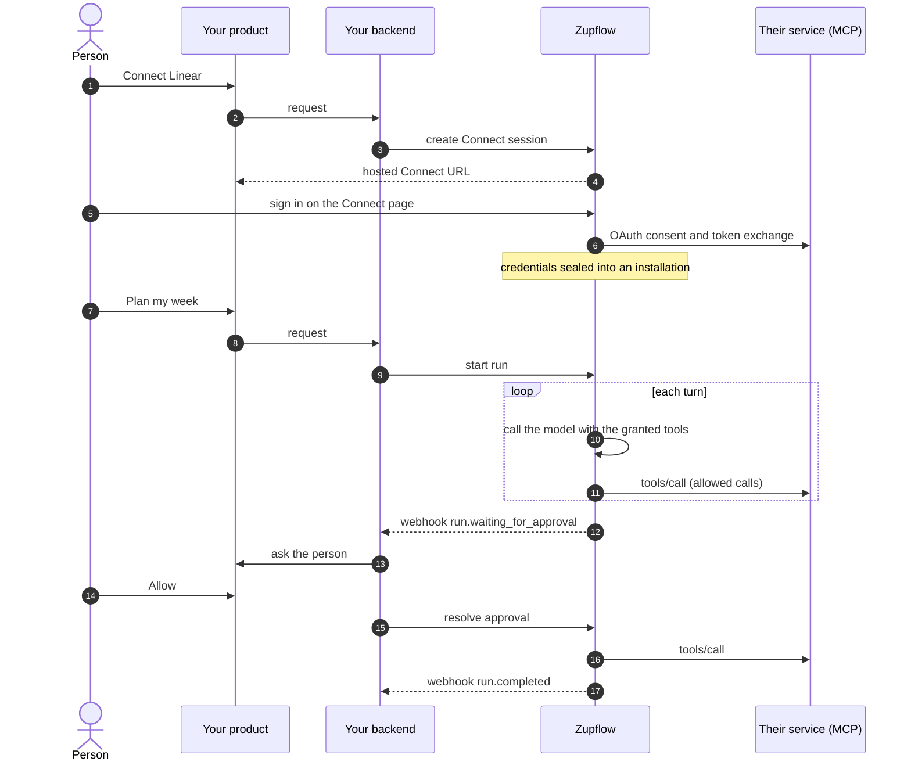
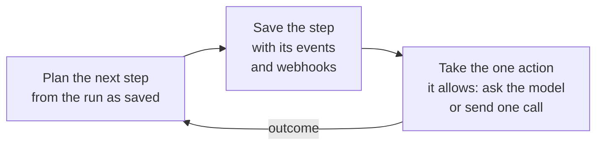

import StepStrip from "../../components/StepStrip.astro";

Zupflow sits between your product and the services your customers use. Your backend talks to it with an API key; your customers only ever see your product and, once per account, the hosted Connect page.

## The flow

<StepStrip
  steps={[
    { title: "Workspace", text: "One per customer" },
    { title: "Connect", text: "They link an account" },
    { title: "Grant", text: "You choose the tools" },
    { title: "Run", text: "The agent works" },
    { title: "Approve", text: "A person decides" },
    { title: "Done", text: "Webhook to you" },
  ]}
/>

1. **Your backend creates a workspace** for each of your customers, with your own ID for them as `external_id`.
2. **Your customer connects an account.** Your backend creates a Connect session and sends the person to its URL. Zupflow runs the sign-in, seals the credentials and creates an installation. Zupflow then lists the app's tools for that installation.
3. **You grant an agent tools.** A grant names tools of one installation, and the organization's tool policy bounds what any grant can allow.
4. **Your backend starts a run** with the person's input. Zupflow calls the model with the tools the agent may use, decides each call it asks for, sends the allowed ones to the installation's MCP server with the credential injected last, and records every step as an event.
5. **When a call needs approval,** the run waits and Zupflow sends `run.waiting_for_approval`. Your product asks the person; your backend sends the decision.
6. **When the run finishes,** Zupflow sends `run.completed` (or `run.failed`, `run.cancelled`), and you read its output and events.

## Built to finish what it starts

A run moves one step at a time, and every step is saved, together with its events and the webhooks it causes, before the action it allows is taken. If anything is interrupted, the run picks up from its last saved step. A tool call is sent at most once: one whose outcome was lost is recorded as **unknown** and reported to the model, never sent again.
