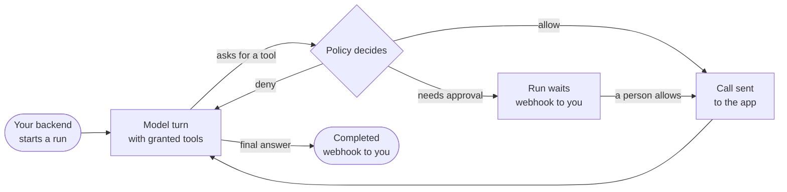

import ProductDiagram from "../../components/ProductDiagram.astro";
import ObjectModel from "../../components/ObjectModel.astro";

Zupflow is the backend for adding **AI agents** to your product. Each agent works inside one of your customers' workspaces, for one person or a whole team, with access to that customer's own connected accounts (their task tracker, their CRM, their docs) and nothing else.

<ProductDiagram />

## What Zupflow does for you

Putting agents in a multi-tenant product means solving the same hard problems every time. Zupflow solves them once, behind one HTTP API.

  <section>
    <h3>You build</h3>
    <ul>
      <li>The experience: where people talk to agents, in your UI</li>
      <li>Which agents exist and what each one is for</li>
      <li>How you ask a person to approve a sensitive call</li>
      <li>What happens with a run's result</li>
    </ul>
  </section>
  <section>
    <h3>Zupflow handles</h3>
    <ul>
      <li>Isolating every customer's data, credentials and runs</li>
      <li>OAuth sign-in to each service, with tokens sealed and refreshed</li>
      <li>Deciding every tool call: allow, ask a person, or deny</li>
      <li>Runs that survive restarts and never send a call twice</li>
      <li>Signed, retried webhooks and a full audit log</li>
    </ul>
  </section>

## The core objects

Everything in Zupflow is one of a few objects, and each lives in exactly one scope. Every ID carries its object's prefix, so `run_034HXHH2LZFzvoaSAhfGVD` is always a run.

<ObjectModel />

| Object | ID prefix | What it is |
| --- | --- | --- |
| **Workspace** | `ws_` | One of your customers, tied to your own ID for them (`external_id`). |
| **App** | `app_` | An MCP server your customers can connect, such as Linear or Notion. |
| **Installation** | `inst_` | One customer's connected account for an app, with its credentials sealed. |
| **Agent** | `agt_` | Instructions and a model, with grants to named tools of installations. |
| **Run** | `run_` | One piece of work an agent does from an input, recorded event by event. |
| **Tool call** | `call_` | One call a run asks for, allowed, waiting for approval, or denied. |
| **Webhook endpoint** | `we_` | A URL of yours that receives signed events. |
| **API key** | `key_` | Your backend's credential, for one environment of one organization. |

## A run, at a glance

Every step is saved before the next one starts, so a run picks up where it left off after any interruption. [How it works](/how-it-works/) follows a request end to end.

## Two environments

Every organization has a Sandbox and a Production environment. A workspace belongs to one, fixed when it's created, and configuration never falls back from one to the other. API keys are per environment too (`zf_test_…` and `zf_live_…`).

## Run it your way

The API, the SDK and everything on these pages are the same wherever Zupflow runs. Zupflow is also open source, so you can run the whole platform yourself: see [Self-hosting](/self-hosting/overview/).

  <a href="/quickstart/">QuickstartAn API key to your first run.</a>
  <a href="/how-it-works/">How it worksFollow a request through the system.</a>
  <a href="/guides/first-agent/">Build your first agentConnect an account, grant tools, run.</a>
  <a href="/reference/api/">API referenceEvery endpoint, with examples.</a>

