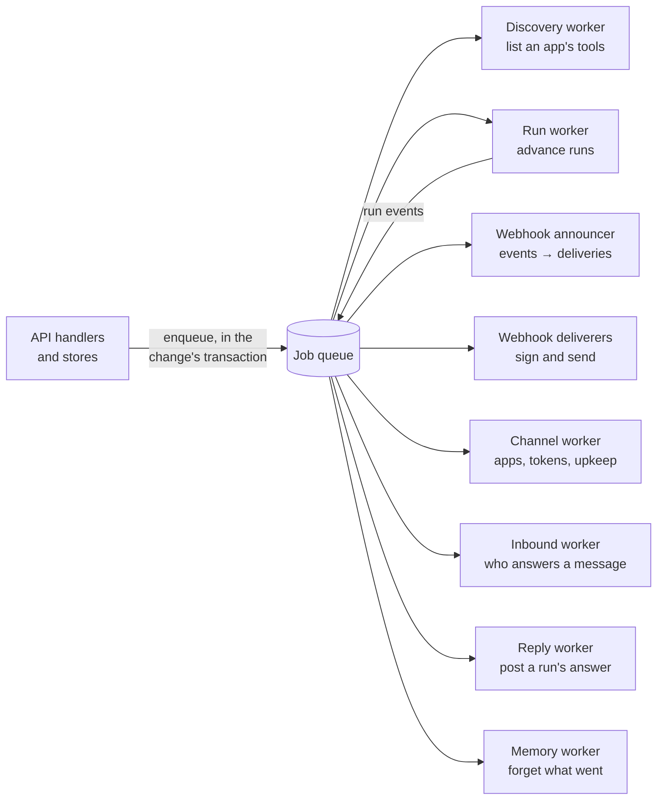
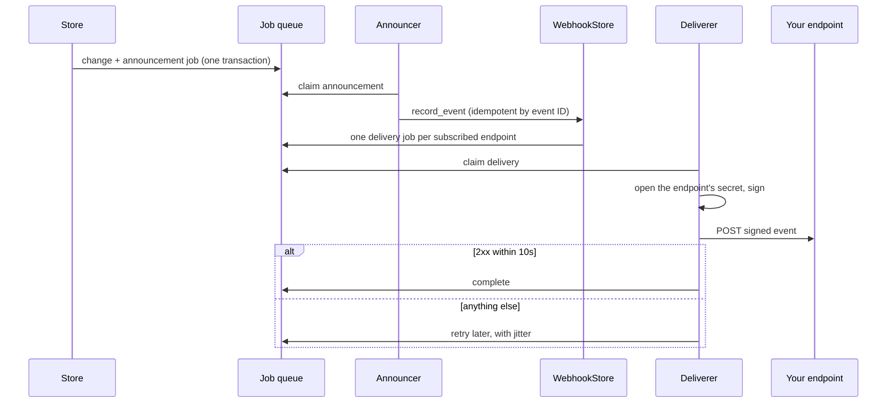
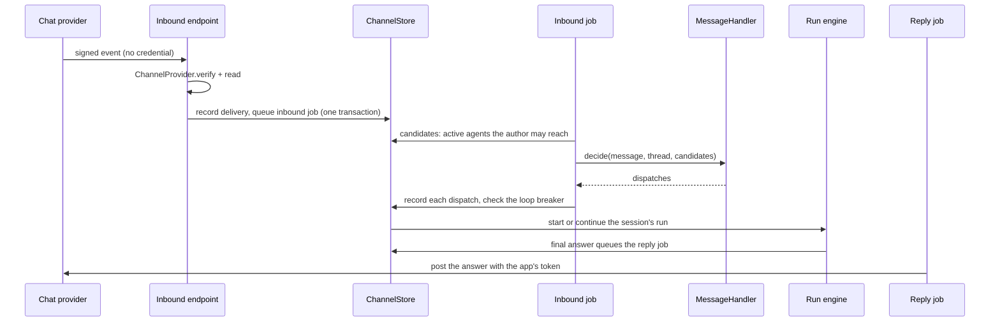

Anything that must happen even if the process stops runs as a **job**. The server's workers run in the same process as the API, each on loops of its own, all claiming from one [`JobQueue`](/self-hosting/architecture/traits/#jobqueue).

## The job queue

A job belongs to the scope it was enqueued in, and a worker gets that scope back with it. Claiming is the one operation that starts without a scope (a worker takes the next job of any organization); everything after it (complete, retry, postpone, bury, extend) names the job's scope again, so a job ID and lease used from another scope reach nothing.

- **Leases.** A claim holds the job for a lease. A worker that crashes or stalls loses it when the lease runs out, and the job is claimed again as its next attempt. A lapsed lease reaches nothing, so a stalled worker can't finish or retry a job it no longer holds.
- **At least once.** Every handler is idempotent, or records what it did before acting.
- **Small payloads.** A job carries references (an event's ID, an installation's ID), never secrets or bulk data. Workers read everything again in the job's own scope.
- **Dead jobs.** A job whose last attempt fails or lapses is dead, never claimed again.

The basic queue lives in the same SQLite database as the stores, which is what lets a change and its jobs commit together.

## The outbox

A change that causes an event never sends it directly. It queues an **announcement** job in its own transaction: the run store when it appends a run event a webhook names, the tool registry when a listing changes a tool. A rolled-back change announces nothing, and a committed one is never lost.

A memory's change goes one step further: it records its `memory.*` event, with a delivery and its job for each subscribed endpoint, in the transaction that makes the change, as the announcer would. A memory is never changed without its events, nor its events written without the change.

## Webhook delivery

Announcements and deliveries run on separate loops, so a slow endpoint never holds up an announcement.

- The announcer reads what the event names, builds the event body once, and records it with one delivery per enabled endpoint of the organization and environment that subscribes to its type.
- Deliverers sign the body with the endpoint's secret (opened at the moment of sending and nowhere else) and send it through [`OutboundHttp`](/self-hosting/architecture/traits/#outboundhttp). Any `2xx` within 10 seconds is success. Anything else is retried after 1 minute, 5 minutes, 30 minutes, then 2, 6, 12 and 24 hours (eight attempts in all, with jitter). The response body is never read or stored.
- An endpoint has one delivery in flight at a time, across every worker.
- Only the endpoint's own failures count as attempts. When Zupflow itself can't send (a store or the key service is down), the job backs off without touching the endpoint.

Delivery is at least once and unordered: a delivery cut off by a restart is sent again with the same event ID. See [Webhooks](/concepts/webhooks/) for verifying signatures.

## Tool discovery

When an installation connects, a job lists its app's tools through the installation's credential and records them in the [`ToolRegistry`](/self-hosting/architecture/traits/#the-stores) as that installation's own. A connect never waits for, or fails because of, discovery.

The registry **pins** each tool's definition. A tool whose definition later changes is marked as changed and can't be called until someone reviews it, so an MCP server can't quietly widen what an agent does.

## Channels

Agents can also be reached in a team's chat. The pieces are the same: jobs, the outbox, and one trait per seam.

- The provider's inbound endpoint holds no credential. The delivery's signature, by the app's own signing secret, authorizes it, and only a verified body is read.
- The [`MessageHandler`](/self-hosting/architecture/traits/#messagehandler) only decides **which** agents answer. The inbound job enforces every rule before and after it: sender lists, automated accounts, other agents, the hop limit and the conversation's loop breaker.
- One run per message. A message in a thread continues the session's run, with its earlier runs as a cached prefix (see [the run engine](/self-hosting/architecture/run-engine/#keeping-the-prompt-cache-warm)).
- The reply job posts a channel run's answer. A retried reply looks for a post whose answer was lost before posting again, so nothing is posted twice.
- The channel worker makes each agent's app at the provider through the [`AppProvisioner`](/self-hosting/architecture/traits/#appprovisioner), rotates tokens, and keeps apps in step with their agents.

## Forgetting memories

Deleting an agent, a workspace or a memory type forgets the memories that went with it. A kind keeps its memories in the database that holds the server's records, so what the database drops with the deletion goes in the deletion's own transaction: that's where the `notes` kind's notes go.

The same transaction queues a `forget_memories` job for each kind of the organization's memory types at that moment (only the type's own kind, for a type), naming what went by its IDs. The memory worker asks the kind to forget whatever else it keeps of it ([`MemoryProvider::forget_all`](/self-hosting/architecture/traits/#memoryprovider)) until it has.

- Forgetting what's gone already is no failure, so a kind can be asked again safely.
- A kind that fails is asked again after half a minute, then twice as long each time, up to an hour apart. After more than three days of failures, the job is given up on, with an error in the log.
- The job of a kind this server doesn't serve is kept without using an attempt, so the kind forgets once a server serves it again. It's looked at again after five minutes, then twice as long each time, up to six hours apart, with a warning each time.

A deletion sends no `memory.forgotten` for the memories that went with it. `deleteMemories` does: it forgets in the request, a hundred memories at a time, oldest first, each hundred in one transaction with a `memory.forgotten` for each memory and one audit event. Between two batches it waits as long as the last one took, up to half a second, so other writers waiting for the database get it first.

A deleted type's memory calls waiting for approval are refused by a job of their own, on the run worker (see [the run engine](/self-hosting/architecture/run-engine/#when-a-type-is-deleted)).
