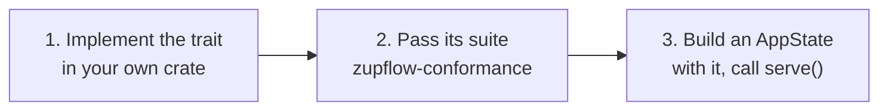

Zupflow ships **basic implementations** of every external resource, enough to run anywhere with nothing but a disk. A deployment that needs more (Postgres, a shared cache, a managed key service, a broker for events) replaces them without forking the server. Replacing an adapter takes three steps.



## 1. Implement the trait

Each trait is in `zupflow-core` and uses `async_trait`. Here is the shape of a shared cache, sketched over a key-value client of your choice:

```rust
use std::time::Duration;
use async_trait::async_trait;
use zupflow_core::scope::{Name, Scope};
use zupflow_core::storage::{Cache, StorageError};

pub struct SharedCache {
    client: MyKvClient,
}

impl SharedCache {
    /// One flat keyspace for every tenant: the scope's prefix keeps them apart.
    fn key(scope: &Scope, key: &Name) -> String {
        format!("{}/{}", scope.storage_prefix(), key.as_str())
    }
}

#[async_trait]
impl Cache for SharedCache {
    async fn get(&self, scope: &Scope, key: &Name) -> Result<Option<Vec<u8>>, StorageError> {
        self.client.get(&Self::key(scope, key)).await.map_err(|error| {
            tracing::warn!(event = "cache.unavailable", %error);
            StorageError::Unavailable
        })
    }

    async fn put(&self, scope: &Scope, key: &Name, value: Vec<u8>, ttl: Duration) -> Result<(), StorageError> {
        // ...set with expiry
    }

    async fn add_if_absent(&self, scope: &Scope, key: &Name, value: Vec<u8>, ttl: Duration) -> Result<bool, StorageError> {
        // ...set-if-not-exists with expiry: atomic, exactly one caller wins
    }

    async fn delete(&self, scope: &Scope, key: &Name) -> Result<(), StorageError> {
        // ...
    }

    async fn delete_scope(&self, scope: &Scope) -> Result<(), StorageError> {
        // ...delete by the scope's prefix, and nothing outside it
    }
}
```

A backend's own error never crosses the trait: log it and answer the trait's error (`Unavailable` here). See [Traits and adapters](/self-hosting/architecture/traits/) for each trait's contract.

## 2. Pass the conformance suite

`zupflow-conformance` holds one suite per trait. It checks behavior, failure modes and the isolation rules, and panics with a message naming the rule that broke. Run it from your crate's own tests:

```rust
#[tokio::test]
async fn shared_cache_conforms() {
    let cache = std::sync::Arc::new(SharedCache::connect_for_tests().await);
    zupflow_conformance::cache::run(cache).await;
}
```

The basic adapters run the same suites: `zupflow-basic/tests/storage.rs` runs `cache::run(Arc::new(MemoryCache::default()))`, and `local_keys.rs` runs `key_service::run(&keys, &other)` with two services holding different keys. If your adapter passes, the server's guarantees (isolation, idempotency, transactional outboxes, durable runs) hold on top of it. An adapter that doesn't pass doesn't ship.

## 3. Wire it into your own binary

The `zupflow` binary is a short `main.rs` that builds an `AppState` and calls `bootstrap::serve`. A deployment with its own adapters writes its own binary doing the same, reusing everything in `bootstrap` that isn't storage:

```rust
use std::sync::Arc;
use zupflow_server::{AppState, bootstrap, config::Config};

#[tokio::main]
async fn main() {
    let config = Config::from_env().expect("configuration");
    let outbound: Arc<dyn zupflow_core::outbound::OutboundHttp> =
        Arc::new(bootstrap::outbound().expect("outbound client"));

    let state = AppState {
        cache: Arc::new(SharedCache::connect().await),        // yours
        keys: Arc::new(ManagedKeys::connect().await),         // yours
        identity: bootstrap::identity(&config).expect("identity"),
        provider: bootstrap::model_provider(&config, &outbound),
        model_catalog: bootstrap::model_catalog(&config, &outbound),
        channel_providers: bootstrap::channel_providers(&config),
        sign_in: bootstrap::sign_in(&config),
        outbound,
        // ...your stores, or the SQLite ones, for every other field
    };

    bootstrap::serve(&config, state, bootstrap::guard(&config), bootstrap::shutdown_signal())
        .await
        .expect("server");
}
```

`serve` starts the workers in the same process and refuses a run store that doesn't commit synchronously.

## Rules for an implementation

- **Both scopes, always.** Every function, query and key names the organization and the workspace explicitly. A globally unique ID never stands in for either.
- **Environments never fall back.** One environment's configuration is never read for the other.
- **Never load every workspace.** Lists page and search on the server.
- **Transactions are the unit.** A run's step commits with its events, webhook announcements, audit rows and jobs, or not at all. Stores and the job queue that must commit together live in one database.
- **Secrets stay sealed.** Never log, return or put a secret in a job; open it at the moment of use.

## Building without local sign-in

A deployment with its own stores builds without default features, which also removes `ZUPFLOW_IDENTITY=local`:

```bash
cargo build --release --locked -p zupflow-server --no-default-features
```
