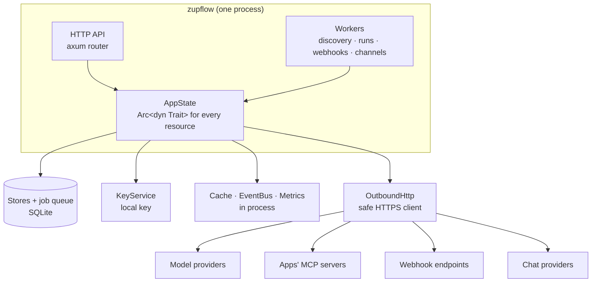

import CrateMap from "../../../../components/CrateMap.astro";

Zupflow's backend is one deployable process: an HTTP API and its background workers, sharing one set of adapters. Everything it touches outside its own memory (the database, the job queue, keys, the cache, the network, models, chat providers) sits behind a trait in `zupflow-core`. The repository ships a working implementation of every one, so a single node runs on SQLite and a disk. A deployment that needs more replaces the adapters without forking the server.



## The crates

The server is a Cargo workspace under `server/crates`, in three layers.

<CrateMap />

| Crate | What it holds |
| --- | --- |
| `zupflow-core` | The shared types (typed IDs, scopes, errors, environments) and every trait: the stores, `JobQueue`, `KeyService`, `Cache`, `ObjectStore`, `EventBus`, `Metrics`, `Identity`, `OutboundHttp`, `ModelProvider`, `ModelProviderCatalog`, `ApprovalPolicy`, `ChannelProvider`, `AppProvisioner`, `MessageHandler`, `Clock`. Also the pure parts of the domain, such as the run reducer and the approval floor. |
| `zupflow-sqlite` | The basic database: every store and the job queue, in one SQLite file, with migrations. |
| `zupflow-basic` | The other basic adapters: local keys, in-memory cache, local files, in-process events and metrics, local sign-in, `ConfiguredPolicy`, and the scripted model, providers and channel provisioner for local work. |
| `zupflow-outbound` | `SafeHttpClient`, the only way the server calls anything: HTTPS only, public addresses only, no redirects, credentials injected last. |
| `zupflow-mcp` | A minimal MCP client over Streamable HTTP: lists tools, calls one, and signs in to an MCP server's own OAuth. |
| `zupflow-providers` | Model provider adapters over plain HTTP: OpenAI, OpenRouter and Anthropic, with no vendor SDK. |
| `zupflow-oidc` | Console sign-in through any OpenID Connect provider. |
| `zupflow-channels` | The fake channel provider, for development and tests. |
| `zupflow-slack` | Slack: generates one app per agent, verifies and reads Slack's events, sends replies. |
| `zupflow-server` | The HTTP API, the background workers, configuration, and the `zupflow` binary. |
| `zupflow-conformance` | One suite per trait. Every implementation, here or elsewhere, runs its suite from its own tests. |
| `zupflow-contract`, `zupflow-taskboard` | Development only: the server the contract suite runs against, and a fake MCP app with its own OAuth. Neither builds for release. |

## Wiring: `AppState`

`AppState` holds one `Arc<dyn Trait>` per resource, and every handler and worker reaches the outside world only through it. The `zupflow` binary's `main.rs` is the whole wiring for the basic build:

```rust
let state = AppState {
    clock: Arc::new(SystemClock),
    identity,                                    // LocalIdentity or OidcIdentity
    organizations: Arc::new(SqliteOrganizationStore::new(database.clone())),
    workspaces: Arc::new(SqliteWorkspaceStore::new(database.clone())),
    // ... every other store on the same SQLite database
    jobs: Arc::new(SqliteJobQueue::new(database.clone())),
    keys: Arc::new(LocalKeyService::from_server_secret(&secret_key)),
    cache: Arc::new(MemoryCache::default()),
    events: Arc::new(InProcessEventBus::default()),
    metrics: Arc::new(InProcessMetrics::default()),
    approvals: Arc::new(ConfiguredPolicy::new(policy_store)),
    provider,                                    // HttpModelProvider, ScriptedModel or none
    outbound,                                    // SafeHttpClient
    // ...
};
bootstrap::serve(&config, state, guard, bootstrap::shutdown_signal()).await
```

`bootstrap::serve` binds the listener, starts the workers in the same process, and serves the router until shutdown. It refuses a run store that doesn't commit synchronously. A deployment with its own adapters writes its own small binary that builds a different `AppState` and calls the same `serve`. See [Extending Zupflow](/self-hosting/architecture/extending/).

## Rules that hold everywhere

- **Two scopes on every call.** Every store method, query, cache key and job names the organization and, where it applies, the workspace. A globally unique ID never stands in for either, and a value in another tenant's scope answers exactly like one that doesn't exist.
- **Environments never fall back.** Sandbox and Production are separate; one's configuration is never read for the other.
- **A transaction is the unit of change.** A change commits with its audit row, its webhook announcements and its jobs, or not at all.
- **Background work is at least once.** Jobs are leased, retried and idempotent; nothing assumes it runs exactly once.
- **Secrets are sealed and scoped.** Each is encrypted with its own data key, bound to its owner, and opened only at the moment of use.

## Read on

- [The request path](/self-hosting/architecture/request-path/): what happens between a request arriving and a response leaving.
- [The run engine](/self-hosting/architecture/run-engine/): how runs move, survive crashes and keep the prompt cache stable.
- [Background work](/self-hosting/architecture/background-work/): the job queue, the outbox, webhooks, discovery and channels.
- [Traits and adapters](/self-hosting/architecture/traits/): every trait, what it does and what implements it.
- [Extending Zupflow](/self-hosting/architecture/extending/): writing and wiring your own adapter.
