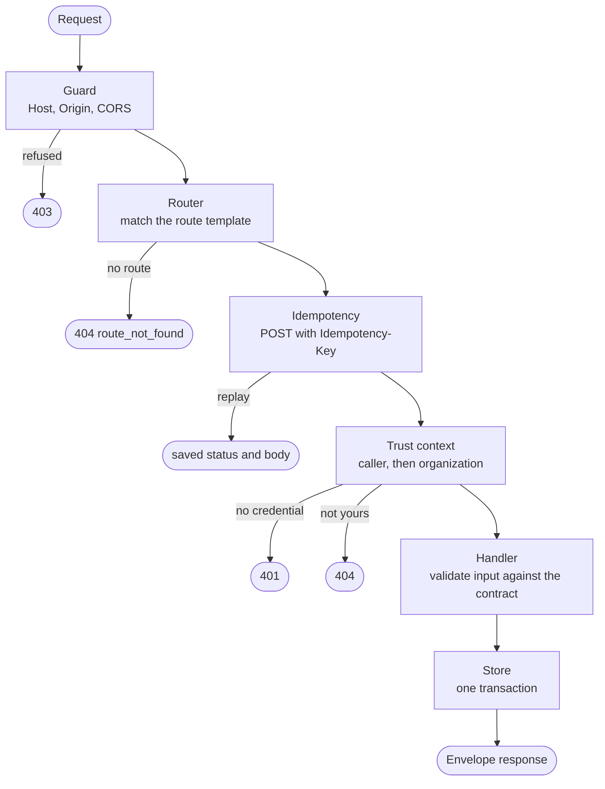
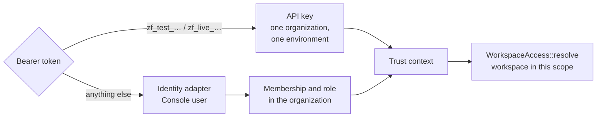

Every API request passes the same layers in the same order. Each one can only narrow what the next sees, so a handler never runs for a request a browser was tricked into sending, a caller without a credential, or an organization the caller can't act in.

## 1. The guard

`guard.rs` runs before any route. Its job is to refuse requests a browser was tricked into sending:

- **Host.** With local sign-in, a request must name the server by a loopback name and its own port. A rebound name that resolves to `127.0.0.1` is refused. The host of `ZUPFLOW_PUBLIC_URL` is admitted only for routes that are public by design (hosted Connect and the channels' inbound endpoint), and no caller is ever resolved for such a request.
- **Origin.** A request with an `Origin` must come from an allowed origin: `ZUPFLOW_ALLOWED_ORIGINS`, or the server's own loopback origin under local sign-in.
- **CORS** is for the Console alone (`ZUPFLOW_CONSOLE_ORIGIN`). No other origin gets a CORS header. Credentials are bearer tokens, never cookies.
- **Content type.** Bodies must be `application/json`, so a cross-site form can't carry one without a preflight.

## 2. Routing

The router is assembled in `zupflow-server`'s `app()`: one `routes()` per domain module (`workspaces`, `installations`, `agents`, `runs`, `webhooks`, …). Every route and its schemas mirror the contract in `@zupflow/contract`, and the contract suite checks the two agree. An unknown path is `404 route_not_found`; a known path with the wrong method is `405`.

## 3. Idempotency

Every `POST` accepts an `Idempotency-Key`, handled by one middleware so no handler, service or table knows about it:

1. The caller is resolved first, exactly as the handler will, so a `401` or `404` is never replayed past its checks.
2. The key belongs to that caller: the organization, the workspace on workspace routes, the environment and the credential.
3. The same key and the same request replays the saved status and body. A different request with that key answers `422`; one still in flight answers `409`.
4. A `5xx` saves nothing, so a retry runs again. A route that shows a secret once saves only that it completed, never the secret.

## 4. The trust context

`auth.rs` establishes who is calling, then which organization and environment they act in, before any ID in the path is parsed.

There are two kinds of caller. An organization's backend uses an **API key**, which belongs to one organization and one environment and sees nothing of the other environment. A Console user signs in through the [`Identity`](/self-hosting/architecture/traits/#identity) adapter and acts with their role in the organization. An organization or workspace the caller can't reach answers `404`, exactly like one that doesn't exist.

## 5. The handler and the store

Handlers are thin. They parse the body against the contract's shape, check what they can without the database, and call one store method with the scope they were given. The store does the rest **in one transaction**:

- re-checks every rule that depends on stored state (an editor's role, a grant held inside the organization's tool levels, a name already taken);
- writes the change;
- writes its **audit row**, built by the caller with the actor and committed with the change;
- queues any **jobs** and **webhook announcements** the change implies (the [outbox](/self-hosting/architecture/background-work/#the-outbox)).

So a committed change always has its audit row and its events, and a rolled-back one has neither.

## 6. The response

Every response under `/v1` uses the same envelope: `data` on success, `error` with a stable `code` on failure. Errors never carry another tenant's IDs or a provider's own words. Lists are paged on the server with a cursor; nothing ever loads every workspace.
