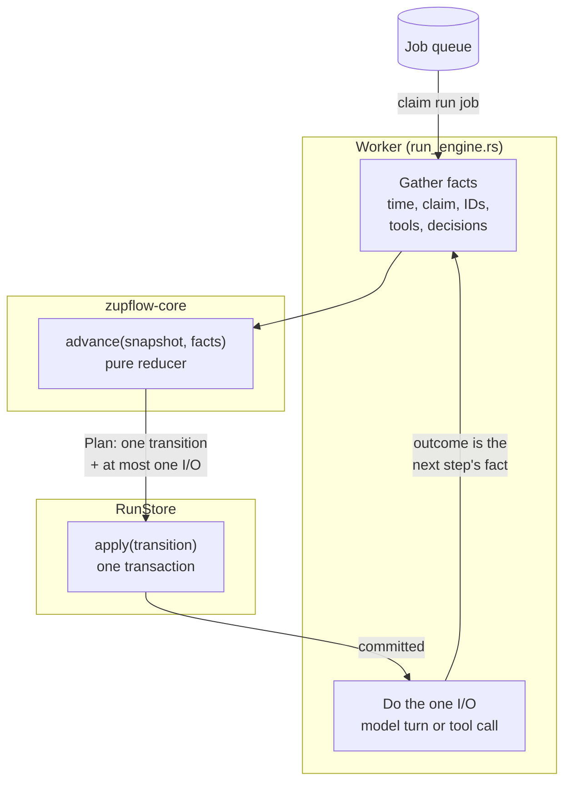
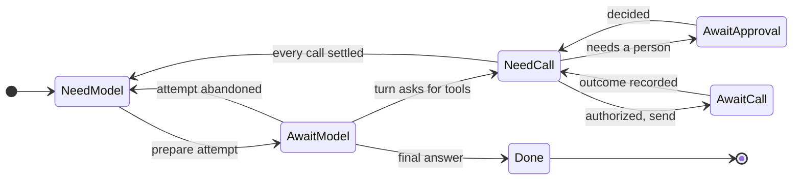
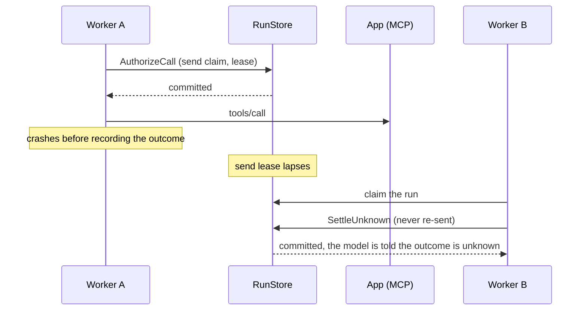
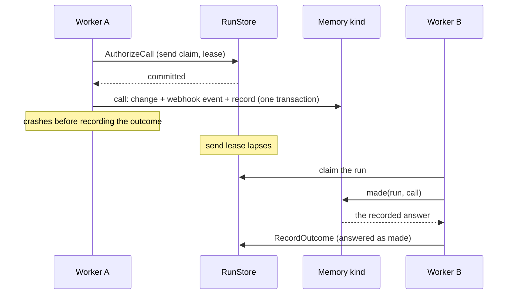

A run is an explicit state machine, driven by workers inside the server. Three pieces keep it honest: a **pure reducer** that plans every step, a **run store** that commits each step with everything it implies, and a **driver** that does the one piece of I/O a committed step allows.

## The reducer

`advance(snapshot, facts) -> Plan` lives in `zupflow-core/src/runs/reducer.rs`. The snapshot is the run as committed; the facts are what the driver brings (the time as it saw it, the claim it holds, fresh IDs, the tools offered, the model's answer, the policy's decisions, a send's outcome). A plan is one transition request and at most one piece of I/O to do after it commits. The same snapshot and facts always give the same plan: the reducer reads no clock, makes no ID and touches no I/O, so every path through it is unit tested.

Each run carries a **continuation**, the step it's on:

## The run store

`RunStore::apply` is the only way a run changes. In one transaction, under its write lock, every adapter:

1. refuses a request whose organization or workspace isn't the caller's;
2. answers the first receipt again for a transition it already committed (so a retried step is harmless);
3. reads the time from its own clock and checks the request's **guards**: the expected revision, the owner's claim and live lease, the send claim, the cancel flag;
4. writes everything the operation implies: the run and its continuation, turns, calls, attempts, the run events (with a gap-free sequence), the **webhook announcements** those events name, the audit row of a control request, and the run's **job** (queued, postponed or released).

All of it commits, or none of it. The server refuses to start on a run store that doesn't commit synchronously: SQLite runs with WAL and `synchronous = FULL`.

## Claims, leases and crashes

A worker claims a run's job from the [job queue](/self-hosting/architecture/background-work/#the-job-queue) with a lease of five minutes, and the run itself under a claimant of the worker's own. The job's lease is extended before every step that keeps the claim. When a step parks, yields or finishes, the same transaction queues, postpones or releases the run's job, so the worker leaves it alone.

A tool call is sent at most once. Before sending, the driver commits an `AuthorizeCall` that holds a **send claim**. If the worker dies after sending but before recording the outcome, the next worker sees a lapsed send lease and settles the call as **unknown** instead of sending it again. A late outcome that arrives afterwards is kept as evidence but doesn't change the run. A memory call is settled differently: the next worker answers it from the record its change left, or makes it then when it left none, like a search (see [Made once](#made-once)).

A sweep every minute fails runs that were abandoned past their limits, so nothing waits forever.

## Deciding a call

Before a call is sent, the driver reads the installation, the grant and the tool's pinned definition again, then asks for a decision:

1. **The floor** (`zupflow_core::policy::floor`) refuses what no policy can allow: a tool the grant doesn't name, an installation that's gone or disconnected, a tool whose definition changed and wasn't reviewed.
2. **The [`ApprovalPolicy`](/self-hosting/architecture/traits/#approvalpolicy)** decides the rest: allow, require approval, or deny. The built-in `ConfiguredPolicy` reads the organization's tool policy and levels. A grant that marks a tool as needing approval is always respected.

Each decision is recorded with the policy's name, the mode in force and the rule that made it.

## The tools a run offers

Tools are offered to the model as `<app_key>_<short_id>_<tool_name>`, one per granted tool of each installation. The list is read **once per run**, at its first model attempt, and frozen: every later attempt offers the same tools with the same descriptions. A grant edited or a tool removed mid-run never changes the list; a call to a tool that's no longer allowed is refused when it's decided or sent, with a fixed message, and a tool granted since waits for the next run.

## A run's memory

A run gets its agent's [memory](/concepts/memory/) with its tools (`memory_tools::resolve`). The engine knows no kind: what a kind recalls, which tools it has and what a call does are its [`MemoryProvider`](/self-hosting/architecture/traits/#memoryprovider)'s.

### Frozen on the run

At the run's first model attempt, the driver reads the agent's memory type (its own, or the organization's default), the kind's tools for the type's settings and `writes`, and what the run recalls in its workspace. The memory tools join the frozen list under their own names, like `save_memory`. The type and the recall are kept on the run, once, so every later attempt (a retry, another worker, a turn after an approval) sends the same tools and the same recall, byte for byte; the store holds each attempt to the recall's digest. Nothing reads the recall again during the run: what a run saves reaches the next one. The recall goes with the run's last transition, and its digest stays.

An agent without memory, or whose type's kind the server doesn't serve, gets no memory tools and no recall. A run started with memory `off` offers the same tools as one with memory, so its tools, instructions and cache key are the same; it recalls nothing, and each memory call is refused (`memory_off`).

A run in a channel session takes its memory from the session instead (see [In a channel session](#in-a-channel-session)).

### The recall and the prompt cache

The recall is the first block of the first user message, before the run's input, and never part of the instructions. The tools and instructions come before it, so a changed memory leaves them cached. With nothing to recall, there's no block, and the request is the one a run without memory sends.

- **Anthropic.** The recall is a `text` block of its own, marked as a cache breakpoint. A request marks four breakpoints at most, the most the Messages API takes: the instructions (or the last tool, when there are none), shared by every run of the agent; the recall, shared by every run with the same memory; the last block of the message before the latest answer, where the turn before put its last one, so a turn that added many blocks still finds it; and the last block of the last message, for the next turn.
- **OpenAI and OpenRouter.** The recall is a `text` part of its own. OpenAI caches a prompt's prefix itself, and OpenRouter does for most hosts. Anthropic's models through OpenRouter (`anthropic/…`) cache only at breakpoints, so their requests are marked as Messages requests are, four at most, except that tools are never marked.
- **The cache key** never covers the recall, so a run whose memory changed shares its agent's key.

### Deciding a memory call

A memory call has no installation or grant, so neither the floor nor the `ApprovalPolicy` decides it. Its decision names the policy `memory`. It's made when the model asks for the call and again just before the call is made, from the run's type as it is then:

1. In a run started with memory `off`, the call is refused (`memory_off`).
2. If the type was deleted (`memory_type_removed`), its kind isn't served (`memory_kind_not_served`), or the kind refuses its settings now (`invalid_memory_settings`), the call is refused.
3. A tool that reads is allowed. A tool that writes takes the type's `writes`: `allow`; `approve`, and the run waits for a person as it does for any approve-level call; or `deny`, refused as read-only. A tool the kind doesn't have is refused like an app's unknown tool.

The type is always the one the run started with, never another. A call refused for one reason fails with one code, whether it was refused when decided, checked before it was made, or as it was made. A call waiting for approval is checked before the run parks on it, so nobody is asked about a call whose type is gone.

### Made once

A memory call is sent like any call: the driver commits an `AuthorizeCall` that holds a send claim, then makes the call in the run's own organization, workspace and agent, in its type, with the type's `writes` as they are at that moment. A call that changes a memory commits, in one transaction, the change, its `memory.*` webhook event with its deliveries, and a record of the call: one per call, never a second. A call that gives a memory the text it already holds commits the record alone. The record's answer names a memory by its short ID, never by its text. The engine writes no audit row for a memory call; the run's timeline is the record.

When the sender stops before recording the outcome, the next worker doesn't settle the call as unknown. It asks the kind what the call did (`MemoryProvider::made`):

- **With a record**, the call is answered as it was made, whatever became of the memory or its type since, and its change is never made again.
- **With none** (a search, a refusal, or a call that was never made), the call is made then. A search searches again.
- **A kind that keeps no record**, or one the server doesn't serve, has the call settled as unknown, like an app's call.

A sender that commits after its call was settled finds the record and changes nothing. Records stay as long as their run's workspace, through erasures of the memories they name, so a settle after an erasure never makes the change again.

### When a type is deleted

Deleting a type queues a `refuse_waiting_calls` job in the same transaction, in the organization's scope, naming the type only. The run worker takes it, finds the calls waiting for approval in that type in any of the organization's workspaces, and refuses each (`memory_type_removed`) through the reducer and the store, so those runs move on without anyone deciding. A decision sent afterwards gets `409 not_waiting`. A call not yet decided is refused by the same rule when it's decided or made.

### In a channel session

A channel run uses the memory its session took when it started: the agent's type, the kind's tools for its `writes`, and the session's audience. Its `memory` is always `agent`. A session in a direct message or group DM recalls and searches the workspace's memories and its conversation's own, and what it saves is stamped with the conversation; one in a channel or private channel has the workspace's only (see [Team chats](/concepts/memory/#team-chats)). A session in a conversation shared with another organization gets no memory tools and recalls nothing, and a conversation that becomes shared gets none from its next session. A session whose type's settings its kind refuses starts without memory, as one whose kind isn't served does, and the server logs it.

The session keeps one recall for each history start, and every run from that start sends the same bytes. A trim reads it again from the session's type. A recall read again takes no more than half the session's history budget (60% of the model's context window), so it can be shorter than `recall_characters`, and a trim counts a kept recall as half the budget at most. What a run saves or changes reaches its own session's later runs through the conversation, and each session's recall at that session's next trim, or in a new session.

Some changes mark sessions in their own transaction, so that each marked session's next run reads its recall again from the same history start:

- **A forget** (`deleteMemory`, each hundred of `deleteMemories`, a run's `forget_memory`) **and an edit through the API or the Console.** A memory kept for one direct conversation marks only that conversation's sessions; a workspace's memory marks every session of its agent, workspace and type. A run's own edit, like a save, marks nothing.
- **Deleting a type** marks every session kept on it. From their next run, they recall nothing, and their memory calls are refused (`memory_type_removed`).

A marked session's next run misses the cache from the recall on, once per mark; a run under way keeps the recall it started with. No session keeps the text a forget or an edit took away: a marked session with no run under way loses its recall text in the marking transaction, and one with a run loses it as that run ends. The session keeps the cleared recall's size, which its trims still count.

Once a run of a session has read an app's tool result, every later save in the session has `after_app_content`, through trims, until the thread starts a new session. A run that uses its session's memory fails with `channel_session_removed` if the session goes with the agent's channel, connection or app while it's under way.

## Keeping the prompt cache warm

Model providers cache the prefix of a prompt. Zupflow keeps that prefix stable on purpose:

- **Append only.** Each turn's request starts with the one before it, byte for byte. Nothing earlier in the conversation is rewritten.
- **Frozen tools and recall.** The tool list, the descriptions and the [recall](#the-recall-and-the-prompt-cache) never change within a run.
- **A stable cache key.** Every turn is sent with the agent's prompt cache key: `zf_` plus a digest of the organization, workspace, agent and tools. Every run of the agent with the same tools shares it, and it names nothing a provider could read.
- **Sessions.** A run in a channel session continues the session's earlier runs from their stored transcripts, so everything before its new messages is a cached prefix. History is trimmed by whole runs, at least a quarter of the budget at a time, so the cache misses once per trim, and from the recall on once per [mark](#in-a-channel-session), rather than on every run.

The server's `prompt_cache` tests guard each of these.

## What gets published

Every event a transition appends is published on the [`EventBus`](/self-hosting/architecture/traits/#eventbus) for the workspace and its environment, as a notification; listeners read the timeline from the store. Every transition is also logged as one structured line and counted through [`Metrics`](/self-hosting/architecture/traits/#metrics), never with a run's input, the model's text, a call's arguments, a memory's text or a run's recall.
