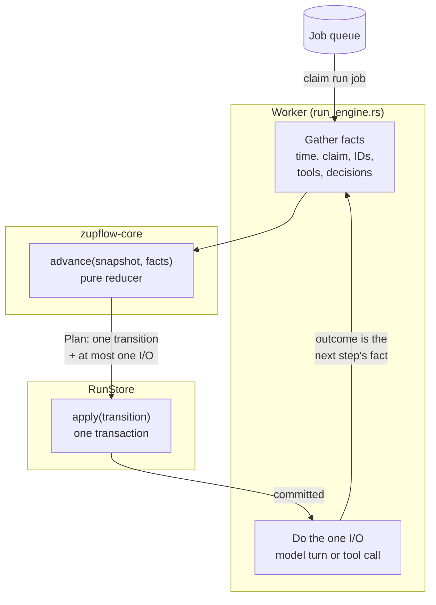
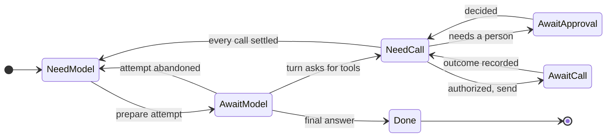
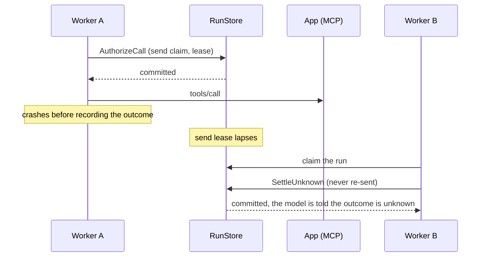

A run is an explicit state machine, driven by workers inside the server. Three pieces keep it honest: a **pure reducer** that plans every step, a **run store** that commits each step with everything it implies, and a **driver** that does the one piece of I/O a committed step allows.

## The reducer

`advance(snapshot, facts) -> Plan` lives in `zupflow-core/src/runs/reducer.rs`. The snapshot is the run as committed; the facts are what the driver brings (the time as it saw it, the claim it holds, fresh IDs, the tools offered, the model's answer, the policy's decisions, a send's outcome). A plan is one transition request and at most one piece of I/O to do after it commits. The same snapshot and facts always give the same plan: the reducer reads no clock, makes no ID and touches no I/O, so every path through it is unit tested.

Each run carries a **continuation**, the step it's on:

## The run store

`RunStore::apply` is the only way a run changes. In one transaction, under its write lock, every adapter:

1. refuses a request whose organization or workspace isn't the caller's;
2. answers the first receipt again for a transition it already committed (so a retried step is harmless);
3. reads the time from its own clock and checks the request's **guards**: the expected revision, the owner's claim and live lease, the send claim, the cancel flag;
4. writes everything the operation implies: the run and its continuation, turns, calls, attempts, the run events (with a gap-free sequence), the **webhook announcements** those events name, the audit row of a control request, and the run's **job** (queued, postponed or released).

All of it commits, or none of it. The server refuses to start on a run store that doesn't commit synchronously: SQLite runs with WAL and `synchronous = FULL`.

## Claims, leases and crashes

A worker claims a run's job from the [job queue](/self-hosting/architecture/background-work/#the-job-queue) with a lease of five minutes, and the run itself under a claimant of the worker's own. The job's lease is extended before every step that keeps the claim. When a step parks, yields or finishes, the same transaction queues, postpones or releases the run's job, so the worker leaves it alone.

A tool call is sent at most once. Before sending, the driver commits an `AuthorizeCall` that holds a **send claim**. If the worker dies after sending but before recording the outcome, the next worker sees a lapsed send lease and settles the call as **unknown** instead of sending it again. A late outcome that arrives afterwards is kept as evidence but doesn't change the run.

A sweep every minute fails runs that were abandoned past their limits, so nothing waits forever.

## Deciding a call

Before a call is sent, the driver reads the installation, the grant and the tool's pinned definition again, then asks for a decision:

1. **The floor** (`zupflow_core::policy::floor`) refuses what no policy can allow: a tool the grant doesn't name, an installation that's gone or disconnected, a tool whose definition changed and wasn't reviewed.
2. **The [`ApprovalPolicy`](/self-hosting/architecture/traits/#approvalpolicy)** decides the rest: allow, require approval, or deny. The built-in `ConfiguredPolicy` reads the organization's tool policy and levels. A grant that marks a tool as needing approval is always respected.

Each decision is recorded with the policy's name, the mode in force and the rule that made it.

## The tools a run offers

Tools are offered to the model as `<app_key>_<short_id>_<tool_name>`, one per granted tool of each installation. The list is read **once per run**, at its first model attempt, and frozen: every later attempt offers the same tools with the same descriptions. A grant edited or a tool removed mid-run never changes the list; a call to a tool that's no longer allowed is refused when it's decided or sent, with a fixed message, and a tool granted since waits for the next run.

## Keeping the prompt cache warm

Model providers cache the prefix of a prompt. Zupflow keeps that prefix stable on purpose:

- **Append only.** Each turn's request starts with the one before it, byte for byte. Nothing earlier in the conversation is rewritten.
- **Frozen tools.** The tool list and descriptions never change within a run.
- **A stable cache key.** Every turn is sent with the agent's prompt cache key: `zf_` plus a digest of the organization, workspace, agent and tools. Every run of the agent with the same tools shares it, and it names nothing a provider could read.
- **Sessions.** A run in a channel session continues the session's earlier runs from their stored transcripts, so everything before its new messages is a cached prefix. History is trimmed by whole runs, at least a quarter of the budget at a time, so the cache misses once per trim rather than on every run.

The server's `prompt_cache` tests guard each of these.

## What gets published

Every event a transition appends is published on the [`EventBus`](/self-hosting/architecture/traits/#eventbus) for the workspace and its environment, as a notification; listeners read the timeline from the store. Every transition is also logged as one structured line and counted through [`Metrics`](/self-hosting/architecture/traits/#metrics), never with a run's input, the model's text or a call's arguments.
