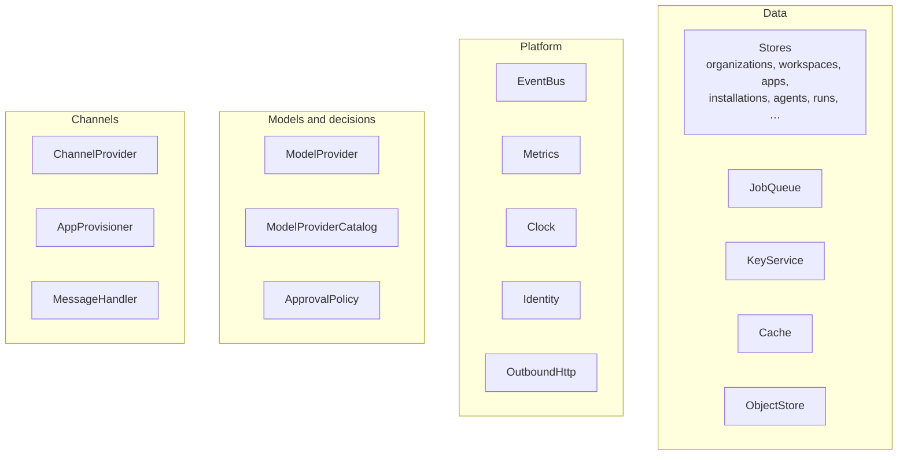

Every resource outside the server's own memory is a trait in `zupflow-core`. The server holds each one as an `Arc<dyn Trait>` in `AppState` and never names a concrete type outside `main.rs`. Each trait has a conformance suite in `zupflow-conformance` that every implementation must pass.



## At a glance

| Trait | What it does | Built in |
| --- | --- | --- |
| [The stores](#the-stores) | Every table: organizations, workspaces, API keys, apps, installations, tools, agents, policies, models, runs, webhooks, Connect, channels, audit, idempotency | SQLite (`zupflow-sqlite`) |
| [`JobQueue`](#jobqueue) | Durable background work with leases | SQLite, in the same database |
| [`KeyService`](#keyservice) | Wraps and unwraps the data keys that seal secrets | `LocalKeyService`, from `ZUPFLOW_SECRET_KEY` |
| [`Cache`](#cache) | Short-lived values that can be rebuilt | `MemoryCache`, in process |
| [`ObjectStore`](#objectstore) | Files and objects | `LocalObjectStore`, on disk |
| [`EventBus`](#eventbus) | Publish and subscribe, by scope and topic | `InProcessEventBus` |
| [`Metrics`](#metrics) | Counts and timings | `InProcessMetrics`, bounded |
| [`Clock`](#clock) | Where the time comes from | `SystemClock` |
| [`Identity`](#identity) | Verifies a Console user's bearer token | `LocalIdentity`, `OidcIdentity` (`zupflow-oidc`) |
| [`OutboundHttp`](#outboundhttp) | Every call out of the server | `SafeHttpClient` (`zupflow-outbound`) |
| [`ModelProvider`](#modelprovider) | Answers one turn of a run | `HttpModelProvider` (`zupflow-providers`), `ScriptedModel`, `NoModelProvider` |
| [`ModelProviderCatalog`](#modelprovidercatalog) | Checks a provider key and lists its models | `HttpProviderCatalog`, `ScriptedProviders`, `NoProviders` |
| [`ApprovalPolicy`](#approvalpolicy) | Allows, holds or denies each tool call | `ConfiguredPolicy` |
| [`ChannelProvider`](#channelprovider) | Reads a chat provider's events and sends replies | `SlackChannelProvider` (`zupflow-slack`), `FakeChannelProvider` |
| [`AppProvisioner`](#appprovisioner) | Creates each agent's app at a chat provider | `SlackProvisioner`, `ScriptedChannelProvisioner`, `NoChannelProvisioner` |
| [`MessageHandler`](#messagehandler) | Decides which agents answer a new message | `MentionHandler` |

## Data

### The stores

`OrganizationStore`, `WorkspaceStore`, `ApiKeyStore`, `AppStore`, `InstallationStore`, `ToolRegistry`, `AgentStore`, `ToolPolicyStore`, `ModelStore`, `RunStore`, `WebhookStore`, `ConnectStore`, `ChannelStore`, `AuditStore` and `IdempotencyStore`. Each is a domain-shaped interface (`create_workspace`, `apply` a run transition, `record_event`), not a generic repository, so the rules live next to the data.

What every store guarantees:

- **Both scopes, always.** Every method takes the organization and, where it applies, the workspace. A value in another scope answers `NotFound`, exactly like one that doesn't exist.
- **One transaction per change**, with its audit row, its outbox announcements and its jobs.
- **Re-checks inside the transaction.** A grant is held to the organization's tool levels; an editor's role is read again.
- **Paged lists**, searched on the server.

The basic stores share one SQLite file (WAL, `synchronous = FULL`), opened by `zupflow_sqlite::Database` with its migrations.

### JobQueue

```rust
async fn enqueue(&self, scope: &Scope, kind: &Name, payload: Vec<u8>, options: JobOptions) -> Result<JobId, JobError>;
async fn claim_next(&self, kinds: &[Name], lease: Duration) -> Result<Option<Job>, JobError>;
async fn complete(&self, scope: &Scope, id: JobId, lease: &LeaseToken) -> Result<(), JobError>;
async fn retry(&self, scope: &Scope, id: JobId, lease: &LeaseToken, after: Duration, reason: &Name) -> Result<Retry, JobError>;
async fn postpone(&self, scope: &Scope, id: JobId, lease: &LeaseToken, after: Duration) -> Result<(), JobError>;
async fn bury(&self, scope: &Scope, id: JobId, lease: &LeaseToken, reason: &Name) -> Result<(), JobError>;
async fn extend(&self, scope: &Scope, id: JobId, lease_token: &LeaseToken, lease: Duration) -> Result<(), JobError>;
```

Durable once `enqueue` returns, leased, at least once. A lapsed lease reaches nothing. `claim_next` is the one cross-tenant call. A queue outside the database loses the "change and its jobs commit together" guarantee, so a replacement queue usually lives in the same database as the stores. See [the job queue](/self-hosting/architecture/background-work/#the-job-queue).

### KeyService

```rust
async fn wrap(&self, context: &EncryptionContext, key: &DataKey) -> Result<WrappedKey, KeyError>;
async fn unwrap(&self, context: &EncryptionContext, wrapped: &WrappedKey) -> Result<DataKey, KeyError>;
```

Envelope encryption: each secret (an installation's credentials, an OAuth client secret, a webhook signing secret, a model provider key) is encrypted with its own random data key, and only the data key goes to the `KeyService`. Both layers are bound to an `EncryptionContext` naming the owner, so a secret can't be opened under another tenant's context. A wrong context, a tampered ciphertext and an unknown key are all the same `Refused`. The built-in service derives its key from `ZUPFLOW_SECRET_KEY`; a deployment can plug in a managed key service.

### Cache

```rust
async fn get(&self, scope: &Scope, key: &Name) -> Result<Option<Vec<u8>>, StorageError>;
async fn put(&self, scope: &Scope, key: &Name, value: Vec<u8>, ttl: Duration) -> Result<(), StorageError>;
async fn add_if_absent(&self, scope: &Scope, key: &Name, value: Vec<u8>, ttl: Duration) -> Result<bool, StorageError>;
async fn delete(&self, scope: &Scope, key: &Name) -> Result<(), StorageError>;
async fn delete_scope(&self, scope: &Scope) -> Result<(), StorageError>;
```

Derived values only: anything in it can be rebuilt, so losing an entry is never an error. Keys are validated names inside a `Scope`, and an implementation over a flat keyspace uses `Scope::storage_prefix`, whose prefixes (`org/{id}/o/…`, `org/{id}/e/{env}/…`, `org/{id}/w/{ws}/…`) are disjoint by construction. `add_if_absent` is atomic: of concurrent callers on one key, exactly one wins.

### ObjectStore

Files and objects (icons, exports, attachments), under the same scoped layout as the cache. The built-in store writes local files. The trait and its suite are in place; the server doesn't store objects yet.

## Platform

### EventBus

```rust
async fn publish(&self, scope: &Scope, topic: &Name, payload: Vec<u8>) -> Result<(), EventError>;
async fn subscribe(&self, scope: &Scope, topic: &Name) -> Result<Subscription, EventError>;
```

Notifications by scope and topic. The run engine publishes each run event on the workspace's and the environment's topic; listeners read the timeline from the store, so a missed notification loses nothing. The built-in bus is in process; several server instances would share one over a broker.

### Metrics

Records one measurement in a workspace with its environment, with at most one label (a code or an outcome kind) and a duration for timings. Never fails and never waits on I/O. The built-in implementation is bounded and in process.

### Clock

Where the time comes from. Every deployment uses `SystemClock`; tests bring a clock they move themselves, so leases and delays expire exactly when a test says.

### Identity

```rust
async fn verify(&self, bearer: Option<&str>) -> Result<VerifiedIdentity, IdentityError>;
```

Verifies a Console request's bearer token and vouches for `(issuer, subject)` with a profile. `OidcIdentity` accepts any OpenID Connect provider: an asymmetrically signed JWT from the issuer's key set, with the configured audience. `LocalIdentity` (`ZUPFLOW_IDENTITY=local`) makes every Console request the built-in owner, for one person on their own machine, and builds only with the `local-identity` feature.

### OutboundHttp

The one path for every call to a model provider, an MCP server, a webhook endpoint or a chat provider. `SafeHttpClient` allows only HTTPS, only to public addresses (checked after DNS resolution and connected to only at the addresses checked, so DNS rebinding can't slip through), follows no redirects, bounds size and time, injects the credential last and scrubs it from anything that comes back. Failures are classified by what happened, never by what the other side wrote. Which addresses count as public is decided once, in `zupflow_core::outbound::is_public`, so every implementation refuses the same ones.

## Models and decisions

### ModelProvider

```rust
fn name(&self) -> &'static str;
async fn complete(&self, access: &ProviderAccess<'_>, turn: &Turn<'_>) -> Result<Completion, ProviderError>;
```

Answers one turn: messages and tools in, text or tool calls out, with the tokens it took. The adapters in `zupflow-providers` speak OpenAI's and OpenRouter's chat completions and Anthropic's Messages API over plain HTTP, with the organization's own key; no vendor SDK and no key lives in the repository. Selected with `ZUPFLOW_MODEL_PROVIDER`: `providers`, `scripted` (local work), or unset, where every run fails `model_unavailable`.

Every implementation refuses a malformed turn, answers a completion `validate_completion` accepts, reports a refused key as `KeyRefused` and an unknown model as `UnknownModel`, and never puts the key in what it answers or logs.

### ModelProviderCatalog

Checks a provider key and lists the models it serves, for the organization's model connections. Same adapters, same rules: the same models in the same order for the same key, and a refused key is `KeyRefused` whatever the provider.

### ApprovalPolicy

```rust
fn name(&self) -> &'static str;
async fn decide(&self, call: &ToolCall) -> Decision;
```

Decides each tool call: `Allow`, `RequireApproval { reason }` or `Deny { reason }`. The `ToolCall` carries the organization, workspace, agent, installation, app, tool, its registry status, how the grant names it, and the organization's level for it.

Every implementation holds to **the floor** (`zupflow_core::policy::floor`): it never allows a tool the grant doesn't name, one the grant requires approval for, or one that changed and wasn't reviewed. A reason is written for the model and the person deciding: plain, and never empty. `ConfiguredPolicy` reads the organization's tool policy and levels from the `ToolPolicyStore`, and waits for approval when they can't be read.

## Channels

### ChannelProvider

One chat provider's side of a connection: which headers carry its signature, checking a delivery's timestamp, verifying it with the app's signing secret, and reading it into Zupflow's terms (`InboundDelivery`). Optional methods, each defaulting to `Unsupported`, look up a person, post, find a post whose answer was lost, edit, delete, react, open a DM, read recent messages and show that the agent is working. Every call goes through the `OutboundHttp` it's given. `SlackChannelProvider` speaks Slack's Events API; `FakeChannelProvider` reads the same wire format for development and tests.

### AppProvisioner

Creates, changes and deletes one agent's app in one linked team, with the team's current tokens, and installs it with the consent a person gives on the provider's page. `SlackProvisioner` generates one Slack app per agent from a manifest. Selected with `ZUPFLOW_CHANNEL_PROVISIONER`: `slack`, `scripted` (local work), or unset, where teams can't be linked.

### MessageHandler

```rust
fn kind(&self) -> HandlerKind;
async fn decide(&self, input: &HandlerInput<'_>) -> Result<Vec<Dispatch>, ApiError>;
```

Decides which agents answer a new message. It proposes; the inbound job enforces every rule before and after it. It only ever sees candidates the author may reach, and it can't start a run itself. `MentionHandler` answers a DM, a mention, or a follow-up in a thread the agent was addressed in. A new handler is a second implementation with no change to the job or the store.

## Internal seams

Two more traits are seams inside the server rather than adapters you replace: `ToolPort` in `zupflow-server`, how a run reaches an app's MCP server (implemented over `zupflow-mcp`), and `Kind`, the sealed trait behind typed, prefixed IDs.
