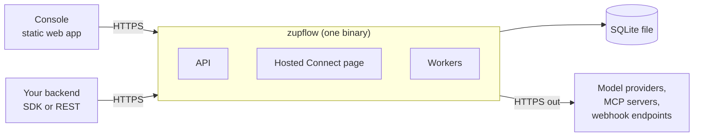

import { Aside, FileTree, Steps } from "@astrojs/starlight/components";

Zupflow is open source under Apache-2.0. Everything the API offers runs from this repository: the server, the hosted Connect page and the Console. This section is for running it yourself; nothing here changes how your product talks to the API.

## What you run

The server is one binary, `zupflow`. It serves the API, the hosted Connect page and the background workers, and keeps its data in one SQLite file. The Console is a static web app that talks to the server.



Every external resource (the database, the job queue, keys, the cache, model providers) is behind a trait, with a working implementation in the repository. A deployment that needs Postgres, a managed key service or a shared cache replaces them without forking. [Architecture](/self-hosting/architecture/overview/) explains how the pieces fit, and [Extending Zupflow](/self-hosting/architecture/extending/) how to swap one.

## Try it locally

This runs the server on port `8080` and the Console in your browser, with a scripted model, so you need no provider account or API key. It takes a few minutes, most of them compiling the server the first time.

### Requirements

- Node 22+ and pnpm 10
- Rust, at the version pinned in `server/rust-toolchain.toml` (rustup picks it up)

### Run it

<Steps>

1. Clone the repository and install dependencies.

   ```bash
   git clone https://github.com/zupflow-hq/zupflow.git
   cd zupflow
   pnpm install
   ```

2. Start the server. The `dev` script uses `local` identity (no sign-in: you are the server's built-in owner) and the scripted model.

   ```bash
   ZUPFLOW_CONSOLE_ORIGIN=http://localhost:5180 pnpm --filter @zupflow/server dev
   ```

3. In another terminal, start your first run.

   ```bash
   pnpm try
   ```

   It sets up an organization, a scripted model as Sandbox's default and a Sandbox API key, then, with that key as your backend would, a workspace, an agent and a run. It prints the run's answer, the API key and a `curl` for the next run. Running it again reuses what's there and prints a fresh API key.

4. Start the Console against the server to watch it.

   ```bash
   VITE_ZUPFLOW_API_URL=http://localhost:8080 pnpm dev
   ```

5. Open [http://localhost:5180](http://localhost:5180). The **Acme (local)** organization holds the workspace, agent and run `pnpm try` made.

</Steps>

<Aside type="tip" title="No server yet?">
  Run `pnpm dev` without `VITE_ZUPFLOW_API_URL` and the Console serves every request from an in-browser mock of the API,
  seeded with a fictional organization. Choose **Continue as Jordan Lee** to explore it.
</Aside>


Then follow the [Quickstart](/quickstart/) with `http://localhost:8080` as your API URL. Locally, the scripted providers accept any key of the right shape (20 to 500 characters, no spaces), so you can connect one without an account. With the scripted model, a line `call <tool> <json>` in a run's input calls a tool; anything else is echoed back. To try the full OAuth flow locally, use Taskboard, a fake MCP app: see [Development](/contributing/development/#taskboard).

## The repository

<FileTree>
- apps/
  - console/ the developer Console (Vite, React, TanStack)
  - docs/ this site
- packages/
  - contract/ zod schemas, the route table and the generated `openapi.json`
  - contract-tests/ the black-box suite every server must pass
  - sdk/ the TypeScript SDK
  - brand/ logos and colors
- server/ the Rust backend, a Cargo workspace
  - crates/
    - zupflow-core/ shared types and the traits for every external resource
    - zupflow-basic/ the basic implementations (keys, cache, files, events, metrics)
    - zupflow-sqlite/ the basic database and job queue
    - zupflow-oidc/ Console sign-in through OpenID Connect
    - zupflow-outbound/ the safe outbound HTTP path
    - zupflow-mcp/ a minimal MCP client
    - zupflow-providers/ OpenAI, Anthropic and OpenRouter adapters
    - zupflow-channels/ the fake channel provider
    - zupflow-slack/ Slack, for agent channels
    - zupflow-conformance/ one suite per trait
    - zupflow-server/ the API server, the `zupflow` binary
</FileTree>

**The contract is the source of truth.** Every request and response is a zod schema in `@zupflow/contract`; the OpenAPI document, the SDK's types and the Console's types are all derived from it, and the same contract suite runs against the in-browser mock and the Rust server.
